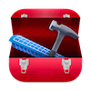

<h1>   Xcodes.app</h1>

The easiest way to install and switch between multiple versions of Xcode.

_If you're looking for a command-line version of Xcodes.app, try [`xcodes`](https://github.com/XcodesOrg/xcodes)._


### :tada: Announcement

XcodesApp is now part of the `XcodesOrg` - [read more here](nextstep.md)

## Features

- List all available Xcode versions from [Xcode Releases'](https://xcodereleases.com) data or the Apple Developer website.
- Install any Xcode version, **fully automated** from start to finish. Xcodes uses [`aria2`](https://aria2.github.io), which uses up to 16 connections to download 3-5x faster than URLSession.
- Automatically resumes installs if network errors.
- Apple ID required to download Xcode versions.
- Just click a button to make a version active with `xcode-select`.
- View release notes, OS compatibility, included SDKs and compilers from [Xcode Releases](https://xcodereleases.com).
- Dark/Light Mode supported
- Security Key Authentication supported 
- Support installing Platforms/Runtimes
- Support installing Apple Silicon variants
- Review and clean developer storage in a separate Clean Up window.

## Clean Up

Clean Up helps you review developer files, caches, and simulator storage. Open it from the bottom-left **Clean Up** button or the app menu. Nothing is selected or deleted automatically.

Xcodes scans on launch. The previous results appear immediately while a background scan refreshes them; the spinner shows when it is running. The window shows the last scan time and identifies cached results. Its **Available to clean up** estimate matches the bottom bar; **Total scanned** also includes incomplete and externally managed storage.

### Default folders

`~` means your home folder. Custom DerivedData and Xcodes storage paths are respected.

| Category | Location |
|---|---|
| Xcode build files | `~/Library/Developer/Xcode/DerivedData` |
| Archives | `~/Library/Developer/Xcode/Archives` |
| Device support | `~/Library/Developer/Xcode/iOS DeviceSupport` |
| Simulator devices | `~/Library/Developer/CoreSimulator/Devices` |
| Simulator runtimes | `/Library/Developer/CoreSimulator` (inventoried through `simctl`) |
| Xcodes downloads | Your configured Xcodes storage folder |

### Your folders

Use **Folders…** or **Settings → Cleanup** to add or remove scan locations. Suggestions include Downloads, device backups, app caches (`~/Library/Caches`), Trash, npm, Cargo, Gradle, and Docker storage; **Choose Folder…** adds any other folder. Removing a location only excludes it from scanning. Removed defaults can be restored through **Add Folder → Developer Folders**.

Added folders default to **1 level**: list immediate entries without opening child folders. Increase **Scan depth**, or choose **Unlimited**, for complete folder sizes. Developer locations scan fully. Recognized `node_modules` folders are also listed. Unreadable or depth-limited folders show unavailable or partial sizes. Protected locations may need Full Disk Access for the running copy of Xcodes, followed by a restart or rescan.

Folder settings are saved in `cleanup-folders.json` beside the Xcode and runtime lists in your configured Xcodes storage directory (normally `~/Library/Application Support/com.robotsandpencils.XcodesApp`). The readable JSON includes `developerFolders` category IDs, added `folders` with absolute `path` values, and `scanDepth` (`0` means unlimited). Edit it outside Xcodes, then restart or click **Rescan** to reload. IDs and names for added folders are optional. Existing preferences migrate automatically; invalid JSON is reported without overwriting it.

### Cleaning

Cleanup shows the current item and batch progress in the window and bottom bar. Closing the cleanup window keeps it running while Xcodes stays open. **Stop after current item** leaves remaining items untouched. Failures remain available for review.

- Select categories or individual rows. Use the OS filter to find older simulator, runtime, and device-support versions; changing the filter clears selections.
- Ordinary files move to Trash after confirmation. Space is reclaimed when Trash is emptied in Finder; Xcodes does not empty it.
- Shut-down simulator devices and eligible runtimes are removed through `simctl`. This permanently removes device data or uninstalls the runtime. Xcode associations are shown during confirmation.
- Docker, backups, and existing Trash are review/manage-only. Active tools, Xcodes operations, and changed targets can block cleanup; failures are reported individually.

Successful cleanup updates the results and persisted amount without rescanning. Use **Rescan** for changes made outside Xcodes. Changing folders or depth invalidates the cache.

## Platforms/Runtimes

- Xcodes supports downloading the Apple runtimes via the app. Simply click on the Platform, and Xcodes will install automatically for you.
- Platforms are listed in the order iOS, watchOS, visionOS, tvOS, with the newest version first.
- Uninstall an installed platform with the **Uninstall** button next to it in the Xcode's Platforms list.
- When uninstalling an Xcode, choose **Uninstall with Platforms** to also remove the simulator platforms that only that Xcode uses. Platforms that another installed Xcode still uses are never offered for removal.

**Note: iOS 18+, tvOS 18+, watchOS 11+, visionOS 2+ requires that Xcode 16.1 Beta 3+ be installed and active.** 

## Apple Silicon Variants

As of Xcode 26, Apple provides Apple Silicon as well as Universal variants for Xcode versions as well as each runtime. Simply tap on which variant you want installed. To install the Apple Silicon runtime variant Xcode 26 is required to be active.

## Experiments

- Thanks to the wonderful work of [https://github.com/saagarjha/unxip](https://github.com/saagarjha/unxip), turn on the experiment to increase your unxipping time by up to 70%! More can be found on his repo, but bugs, high memory may occur if used.


## Localization

Xcodes supports localization in several languages.

The following languages are supported because of the following community users!

|||||
|-|-|-|-|
|French 🇫🇷 |[@dompepin](https://github.com/dompepin)|Italian 🇮🇹 |[gualtierofrigerio](https://github.com/gualtierofrigerio)|
|Spanish 🇪🇸🇲 |[@cesartru88](https://github.com/cesartru88)|Korean 🇰🇷 |[@ryan-son](https://github.com/ryan-son)|
|Russian 🇷🇺 |[@alexmazlov](https://github.com/alexmazlov)|Turkish 🇹🇷 |[@egesucu](https://github.com/egesucu)|
|Hindi 🇮🇳 |[@KGurpreet](https://github.com/KGurpreet)|Chinese-Simplified 🇨🇳|[@megabitsenmzq](https://github.com/megabitsenmzq)|
|Finnish 🇫🇮 |[@marcusziade](https://github.com/marcusziade)|Chinese-Traditional 🇹🇼|[@itszero](https://github.com/itszero)|
|Ukranian 🇺🇦 |[@gelosi](https://github.com/gelosi)|Japanese 🇯🇵|[@tatsuz0u](https://github.com/tatsuz0u)|
|German 🇩🇪|[@drct](https://github.com/drct)|Dutch 🇳🇱|[@jfversluis](https://github/com/jfversluis)|
|Brazilian Portuguese 🇧🇷|[@brunomunizaf](https://github.com/brunomunizaf)|Polish 🇵🇱|[@jakex7](https://github.com/jakex7)|
|Catalan|[@ferranabello](https://github.com/ferranabello)|Greek 🇬🇷|[@alladinian](https://github.com/alladinian)
|Thai 🇹🇭|[@neetrath](https://github.com/neetrath)|Swedish 🇸🇪|[@dhindrik](https://github.com/dhindrik)|

Want to add more languages? Simply create a PR with the updated strings file.

## Installation
v1.X - requires macOS 11 or newer
v2.X - requires macOS 13
v3.X - requires macOS 13 - architecture variants and updated icon.

### Install with Homebrew

Developer ID-signed and notarized release builds are available on Homebrew. These don't require Xcode to already be installed in order to use.

```sh
brew install --cask xcodes
```

### Manually install

1. Download the latest version [here](https://github.com/XcodesOrg/XcodesApp/releases/latest) using the **Xcodes.zip** asset. These are Developer ID-signed and notarized release builds and don't require Xcode to already be installed in order to use.
2. Move the unzipped `Xcodes.app` to your `/Applications` directory

## Support

Xcodes.app and CLI is updated, maintained with contributors like yourself. Even open source libraries and tools come with expenses. If you would like to support Xcodes or donate to the development and maintenance of the tool, it would be greatly appreciated. There is absolutely no obligation!

<a href="https://opencollective.com/xcodesapp" target="_blank">
				
</a>

## Development

You'll need macOS 15.6 Ventura and Xcode 26 in order to build and run Xcodes.app.

The Clean Up window uses [XcodesCleanupKit](https://github.com/XcodesOrg/XcodesCleanupKit), pinned to version 1.0.0. Default folders come from `FindingCatalog.developer(...)`; Add Folder suggestions and their metadata come from `FindingCatalog.OptionalFolder` and `optional(home:)`. Folder models and the JSON configuration schema also live in the package; Xcodes owns saving and reloading the file. OS metadata, category candidate queries, and read-only classification are shared as well. Other UIs can use the same APIs. Xcode resolves the package from GitHub. See the package README for independent tests, API examples, and performance verification. The existing CLI does not depend on it.

### Known build warnings

The following dependency and helper limitations remain:

- `ld: building for macOS-14.6, but linking with dylib '@rpath/libcbor.0.11.0.dylib' which was built for newer version 15.0`: the prebuilt `libcbor` in LibFido2Swift targets macOS 15 while the app targets 14.6. Resolving it means raising the app's deployment target or rebuilding that dependency for 14.6.
- `SMJobBless` is deprecated in favor of `SMAppService`. The one legacy call is isolated in a marked shim in `HelperClient.swift` until the privileged helper moves to `SMAppService`, which uses a different install and approval model.

`Unxip` and `aria2` must be compiled as a universal binary
```
# compile for Intel
 swiftc -parse-as-library -O -target x86_64-apple-macos11 unxip.swift
# compile for M1
 swiftc -parse-as-library -O -target arm64-apple-macos11 unxip.swift

# combine for universal binary
 lipo -create -output unxip unxip_intel unxip_m1  
# check it
 lipo -archs unxip
```


[`xcode-install`](https://github.com/xcpretty/xcode-install) and [fastlane/spaceship](https://github.com/fastlane/fastlane/tree/master/spaceship) both deserve credit for figuring out the hard parts of what makes this possible.


<details>
<summary>Releasing a new version</summary>

Follow the steps below to build and release a new version of Xcodes.app. For any of the git steps, you can use your preferred tool, but please sign the tag.

```sh
# Update the version number in Xcode and commit the change, if necessary

# Question: Did anything in XPCHelper change?
# - com.xcodesorg.xcodesapp.Helper folder and HelperXPCShared
# - if so, bump the version number in com.xcodesorg.xcodesapp.Helper target.
# Note: you do not have to bump the version number if nothing has changed.
# Note2: If you do bump the version, the end user, must re-install the XPCHelper and give permission again.

# Increment the build number
scripts/increment_build_number.sh

# Commit the change
git add Xcodes/Resources/Info.plist
git commit -asm "Increment build number"

# Tag the latest commit
# Replace $VERSION and $BUILD below with the latest real values
git tag -asm "v$VERSIONb$BUILD" "v$VERSIONb$BUILD"

# Push to origin
git push --follow-tags

# Build the app
# Make sure you have the Xcode Selected you want to build with
scripts/package_release.sh

# Notarize the app
# Do this from the Product directory so the app is zipped without being nested inside Product
# Create a app specific password on appleid.apple.com if you haven't already
# xcrun notarytool store-credentials "AC_PASSWORD" \
#              --apple-id "test@example.com" \
#              --team-id "teamid" \
#               --password "app specific password"

pushd Product
../scripts/notarize.sh Xcodes.zip <MYORG>

# Sign the .zip for Sparkle, note the signature in the output for later
# If you're warned about the signing key not being found, see the Xcodes 1Password vault for the key and installation instructions.
../scripts/sign_update Xcodes.zip
popd

# Go to https://github.com/XcodesOrg/XcodesApp/releases
# If there are uncategorized PRs, add the appropriate label and run the Release Drafter action manually
# Edit the latest draft release
# Set its tag to the tag you just pushed
# Set its title to a string with the format "$VERSION ($BUILD)"
# Polish the draft release notes, if necessary
# Add the signature to the bottom of the release notes in a comment, like:
<!-- sparkle:edSignature=$SIGNATURE -->
# Attach the zip that was created in the Product directory to the release
# Publish the release

shasum -a 256 xcodes.zip
# Update the [Homebrew Cask](https://github.com/XcodesOrg/homebrew-cask/blob/master/Casks/x/xcodes.rb).
```
</details>

## Maintainers

[Matt Kiazyk](https://github.com/mattkiazyk) - [Twitter](https://www.twitter.com/mattkiazyk)

[Twitter](https://twitter.com/xcodesApp) | [GitHub](https://github.com/xcodesOrg) | [Mastadon](https://iosdev.space/@XcodesApp) |
